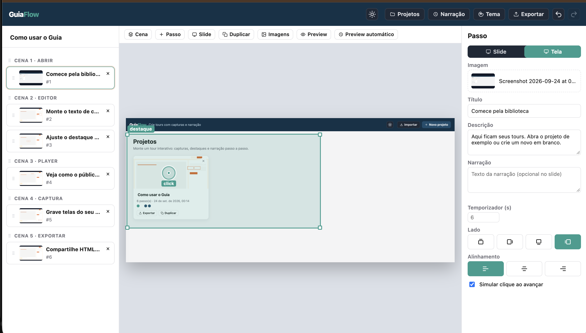
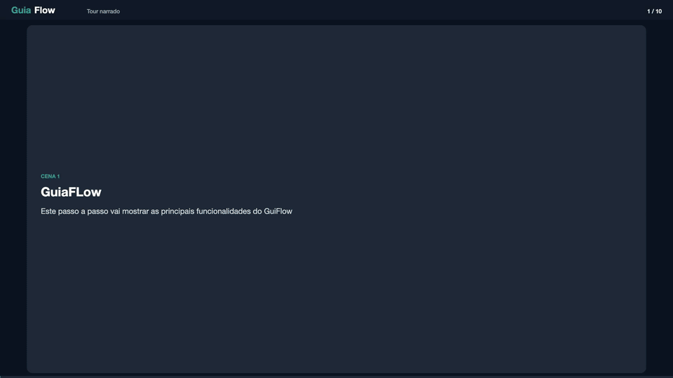

# GuiaFlow

**English** | [Português](README.pt-BR.md)

[](https://smithery.ai/servers/gmistrinelli/guiaflow)
[](LICENSE)

**Free, open-source interactive product demo & guided tour builder — alternative to Arcade, Supademo, Storylane.**

Try it at **[guiaflow.pro](https://guiaflow.pro)** · Editor: [guiaflow.pro/editor](https://guiaflow.pro/editor) · Integrations: [guiaflow.pro/integracoes](https://guiaflow.pro/integracoes)





GuiaFlow is an editor and player for click-through product tours built from screenshots, with highlights, simulated clicks, and narration. It ships with a Chrome extension to capture your product and a desktop app (Electron) with built-in capture.

## Features

- **Screenshot-based interactive demos** — highlight (hotspot), simulated click, and step text on each screen
- **Chrome extension capture** — record your product flow in the browser and turn it into a tour
- **Desktop app (Electron)** — built-in capture window, no extension needed
- **Narration** — AI-generated step text and text-to-speech with your own key (BYOK)
- **Scenes, themes, and fonts** — group steps, pick a ready theme or customize it
- **Start and end steps** — lead-capture intro step and closing CTAs (including WhatsApp)
- **Export** — single-file navigable HTML, MP4 video, or a 7-day temporary preview link
- **Multilingual UI** — Portuguese, Spanish, and English
- **Works offline / locally** — no account required; MIT licensed

## GuiaFlow Pro

**GuiaFlow Pro** is the optional paid plan. The editor and player in this repo stay free and MIT forever.

- **Permanent share links** for published tours
- **Hosted AI text and TTS** — no API key needed in the browser
- **Analytics** for published tours
- **Lead capture**
- **No watermark** on exported video
- **MCP server** at `https://app.guiaflow.pro/mcp` — let AI agents create and publish tours

See [guiaflow.pro](https://guiaflow.pro) for plans and [`docs/CLOUD.md`](docs/CLOUD.md) for how the open editor talks to the hosted service.

## Getting started in the browser

```bash
npm start
```

Opens `http://localhost:4173` (landing) and `http://localhost:4173/editor` (editor). The published editor is [https://guiaflow.pro/editor](https://guiaflow.pro/editor); the root [https://guiaflow.pro](https://guiaflow.pro) is the landing page. Visitors who already have projects in this browser, have the capture extension, or arrive at the root with `?parameters`/`#token=` are sent to `/editor` with the query and hash preserved; `/?landing=1` always shows the landing page. The old address `https://guiaflow-seven.vercel.app` redirects there, keeping the path and query. On the first visit the library gets the **Como usar o Guia** (how to use) project.

The interface is available in Portuguese, Spanish, and English. The language follows the browser; anything else falls back to English. In the editor, the selector is in the top bar (PT, ES, EN). In the extension, the same selector is in the popup and also applies to the on-page capture bar.

### Capture extension

Install it from the [Chrome Web Store](https://chromewebstore.google.com/detail/guiaflow-%E2%80%94-captura/bogjjfmcceccnepkpijiohglllbgbofd). The manual is in [`ajuda.html`](ajuda.html).

To develop the extension locally:

1. `npm run pack:extension` (or load the `extension/` folder)
2. In `chrome://extensions`, enable developer mode and load the extension folder
3. In the popup, the Editor field must be the same origin as the site (`https://guiaflow.pro`, or `http://localhost:4173` in development). After updating the extension, reload its card in `chrome://extensions`.
4. In the popup, pick PT, ES, or EN if you want a language different from the browser's
5. Start capture on the product tab, take screenshots, mark the click, and create the project

## Desktop app

```bash
npm install
npm run desktop
```

Build the local distribution folder (unsigned):

```bash
npm run dist:desktop
```

On desktop, use **Capturar** (Capture) in the editor: it opens a window with the product page, takes screenshots, and builds the project. In the browser, keep using the extension.

## Export

- **Navigable HTML** — a single file with the tour
- **MP4 video** — tour frames via WebCodecs; if the encoder is missing, falls back to `MediaRecorder` (may produce WebM)
- **Temporary preview** — in the Share menu; publishes a short `/v/…` address just for viewing the tour, for 7 days (requires Blob on Vercel)
- **Permanent link** — in the same menu, on the published app. With a session it shows "Connected as …" and publishes directly. Without a session, the confirmation email returns to guiaflow.pro. The cloud HTTP base lives only in `window.__GUIAFLOW_CLOUD__` (see [`docs/CLOUD.md`](docs/CLOUD.md)).

## Tests

```bash
node --test extension/lib/*.test.js scripts/*.test.js
```

## Cloud

The editor and player in this repository remain MIT and free. AI and narration with your own key remain free. GuiaFlow Pro is the optional paid plan, in separate code. Without a base URL, nothing is called. With a base URL, the editor publishes permanent links and offers text, audio, and watermark-free video to subscribers. Details in [`docs/CLOUD.md`](docs/CLOUD.md).

## Links

- Website: [https://guiaflow.pro](https://guiaflow.pro)
- Integrations (MCP, API, embeds): [https://guiaflow.pro/integracoes](https://guiaflow.pro/integracoes)
- MCP server: `https://app.guiaflow.pro/mcp` · [Smithery](https://smithery.ai/servers/gmistrinelli/guiaflow)
- Chrome extension: [Chrome Web Store](https://chromewebstore.google.com/detail/guiaflow-%E2%80%94-captura/bogjjfmcceccnepkpijiohglllbgbofd)

## License

MIT — see [`LICENSE`](LICENSE).

### Third parties

- [driver.js](https://github.com/kamranahmedse/driver.js) 1.3.6 — MIT © Kamran Ahmed (`vendor/driver/`)
- [mp4-muxer](https://github.com/Vanilagy/mp4-muxer) — MIT (`vendor/mp4-muxer/`)
- The Electron build includes Chromium; the packager generates the notices in `LICENSES.chromium.html` in the output folder

This repository does not bundle ffmpeg or libx264.
